# Database Design

The MySQL schema behind the Travel Booking System: 15 tables, 4 triggers,
2 stored functions and 2 stored procedures. The full script is
[`database/tbs_schema.sql`](../database/tbs_schema.sql).

## ER diagram

```mermaid
erDiagram
    Users ||--o{ Users_Booking : makes
    Booking ||--o{ Users_Booking : "shared by"
    Packages ||--o{ Booking : "booked as"
    Payment |o--o| Booking : pays
    Packages ||--|{ PackageInfo : "itinerary stop"
    Destinations ||--o{ PackageInfo : visits
    Hotels |o--o{ PackageInfo : "stay at"
    Transport |o--o{ PackageInfo : "travel by"
    Transport ||--o{ Book_Seat : "has seats"
    Transport ||--o| Flight : "is a"
    Transport ||--o| Train : "is a"
    Transport ||--o| Bus : "is a"
    Transport ||--o| Ship : "is a"
    Destinations ||--o| International : "is a"

    Users {
        int UserID PK
        varchar Email UK
        varchar Password "SHA-256 via trigger"
        date DOB
        int Age "derived from DOB"
    }
    Booking {
        int BookingID PK
        int BookingStatus "0 cancelled, 1 confirmed"
        int PackageID FK
        int PaymentID FK
    }
    Users_Booking {
        int UserID PK, FK
        int BookingID PK, FK
    }
    Packages {
        int PackageID PK
        decimal Price
        date StartDate
        date EndDate
    }
    Payment {
        int PaymentID PK
        decimal Amount
        int PaymentStatus "0 pending, 1 complete"
    }
    PackageInfo {
        int PackageID PK, FK
        int DestNumber PK "order of the stop"
        int DestinationID FK
        varchar HotelID FK
        varchar TransportID FK
    }
    Destinations {
        int DestinationID PK
        varchar DestinationName
        int isInternational
    }
    International {
        int DestinationID PK, FK
        varchar EmbassyContact
        int VISAReqd
    }
    Hotels {
        varchar HotelID PK
        varchar HotelName
        decimal PricePerRoom
    }
    Transport {
        varchar TransportID PK
        decimal TicketPrice
        varchar DepartureLocation
        varchar ArrivalLocation
    }
    Flight {
        varchar TransportID PK, FK
        varchar AirlineName
    }
    Train {
        varchar TransportID PK, FK
        varchar TrainName
        varchar TrainType
    }
    Bus {
        varchar TransportID PK, FK
        int is_AC
    }
    Ship {
        varchar TransportID PK, FK
        varchar CruiseName
        varchar CabinType
    }
    Book_Seat {
        varchar TransportID PK, FK
        int SeatNumber PK
    }
```

## Design decisions

**Specialisation (IS-A) as table-per-subclass.** `Flight`, `Train`, `Bus` and
`Ship` each reuse `TransportID` as both primary key and foreign key to
`Transport`. Shared columns (price, times, locations) live once in the parent;
type-specific columns live in the child. The same pattern models
`International` as a kind of `Destination`. The alternatives were one wide
`Transport` table full of NULLs, or one table per type with the shared columns
repeated and no single table to join itineraries against.

**Ordered itineraries with a composite key.** `PackageInfo (PackageID, DestNumber)`
stores each package as numbered stops, each with its destination, hotel and
transport. `GetPackagePrimaryDestinationName()` reads stop 1.

**Many-to-many users and bookings.** `Users_Booking (UserID, BookingID)` lets a
single booking be shared by a group of travellers.

**Seat double-booking blocked by the database.** `Book_Seat` has the primary key
`(TransportID, SeatNumber)`, so two concurrent requests for the same seat cannot
both succeed. The database enforces it, not application code.

**Consistency rules in triggers.**
- `hash_password_before_insert` / `_before_update`: passwords are stored as SHA-256.
- `trg_SetPaymentID_Null` (insert and update): a cancelled booking cannot keep a payment.

**Atomic booking.** The Java service inserts `Payment`, `Booking` and
`Users_Booking` inside one JDBC transaction (`setAutoCommit(false)` → `commit()`,
or `rollback()` on any failure), so a payment never exists without its booking.

## Known limitations and next steps

- **Fixed:** the update trigger used to re-hash the password on *every* update
  to a user row, so after `CALL UpdateUserAge(...)` the user could no longer log in.
  It now re-hashes only when the password column changes.
- `Age` is stored although it can be derived from `DOB`; computing it in queries
  would remove the need for `UpdateUserAge`.
- New IDs are generated with `MAX(ID) + 1` in Java, which can collide under
  concurrent inserts. `AUTO_INCREMENT` keys would fix this.
- Unsalted SHA-256 is too fast for passwords; a salted, slow hash (bcrypt or
  Argon2) computed in the application would be stronger.
- Flags are `INT` with `CHECK (x IN (0,1))`; `BOOLEAN` or `ENUM` would be clearer.
